## 一、例会信息

**时间**：2026年10月16日

**地点**：北教3-207

**主讲人**：郑鑫城

**主要内容**：Lightroome内训

## 二、文件资料


## 三、Lightroom使用教学

> **适用场景**：活动照片、自摄照片的快速筛选与精修。从导入到导出的完整流程。

---
<details>
<summary>Lightroom教学资料</summary>
## 1. 导入素材与初筛

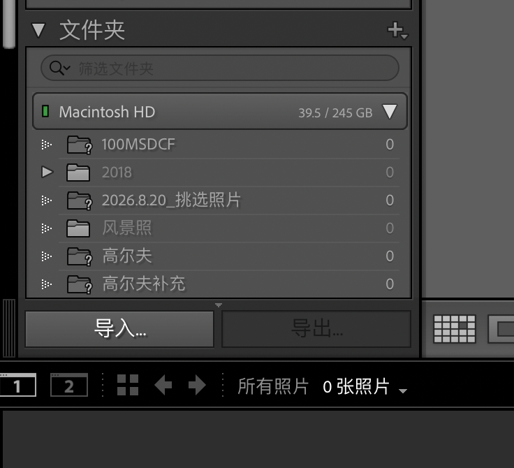
导入照片后，先**初筛**：给照片打上星级（5 级制或 2 级制，随个人习惯）。

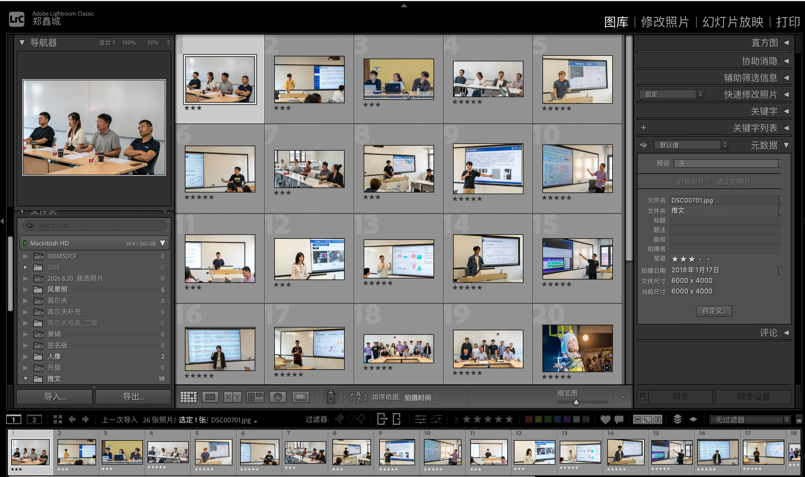
> 💡 **技巧**：照片都是一系列一系列的，不用每张都仔细看——**从每系列中挑选 1~2 张能用的即可**。

---

## 2. 照片裁剪（二次构图）

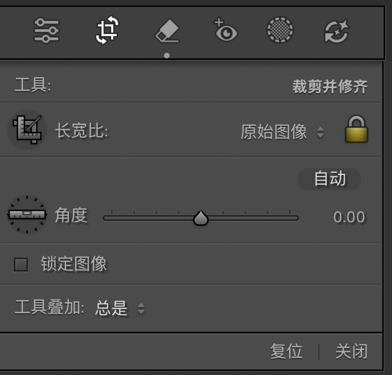

**为什么要裁剪？**

比如下面这张照片，既想拍人，又想拍下后面的大屏幕——**主体不明确**。这时就要通过裁剪来突出主体。
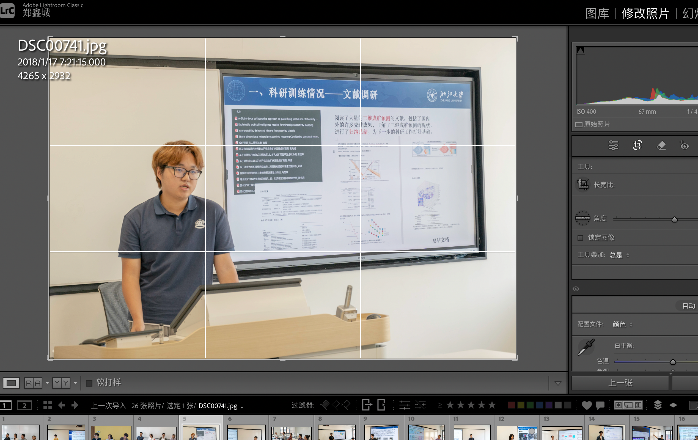

**操作方法**：点击裁剪小图标（右侧直方图下方的第二个图标），框选并保留想要区域即可。
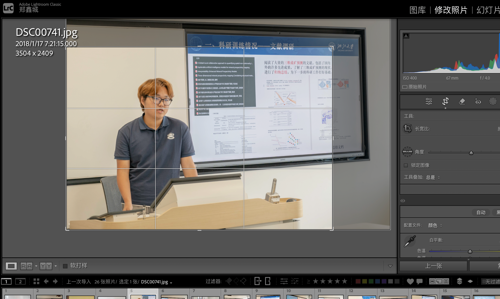

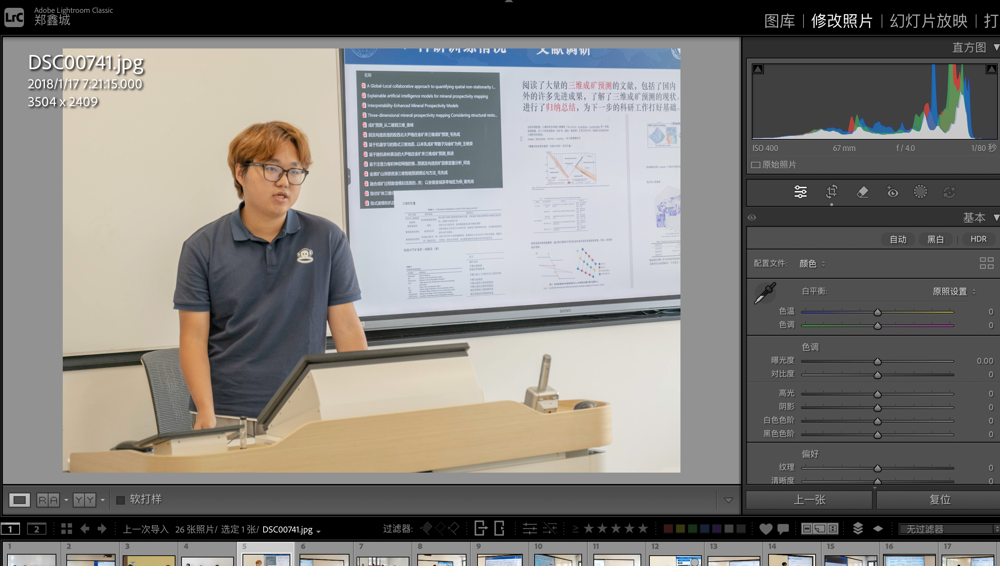
---

## 3. 直方图

<!--  -->

> 直方图下方显示的是照片拍摄时的参数。

### 3.1 坐标轴含义

| 轴 | 含义 |
|---|---|
| **横轴** | 亮度：从最左的纯黑（0）到最右的纯白（255）。左半边是暗部，中间是中间调，右半边是亮部 |
| **纵轴** | 该亮度上的像素**数量**。山丘越高，说明照片里这个亮度的像素越多 |

### 3.2 怎么看直方图

| 直方图形态 | 判断 |
|---|---|
| 山堆在**左边** | 照片偏暗（欠曝） |
| 山堆在**右边** | 照片偏亮（过曝） |
| 山**紧贴左边缘** | 暗部"死黑"，细节丢失（欠曝溢出） |
| 山**紧贴右边缘** | 高光"过曝死白"，细节丢失（高光溢出） |

> ⚠️ 直方图上方的**左右两个小三角**是溢出警告：点击它们，照片里溢出的区域会直接显示红/蓝色警示块。

---

## 4. 调色——基本面板

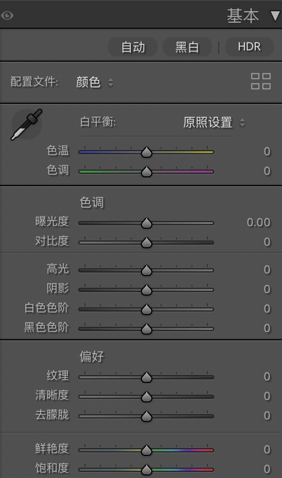

### 4.1 滑块速查表

| 滑块 | 管什么 | 适用情况 | 怎么调 |
|---|---|---|---|
| **色温 / 色调** | 白平衡（画面的黄↔蓝、绿↔品红倾向） | 室内灯光拍得发黄、阴天发蓝 | 先试"白平衡"下拉菜单的预设；追求精准就用**吸管工具**点击照片里本应是灰色的地方 |
| **对比度** | 明暗反差 | 照片发灰、发闷 | 小幅增加（+10~+25）。但更推荐用下面四个滑块分区控制 |
| **高光** | 只管亮部 | 天空过曝、白衬衫死白、舞台灯太亮 | **往左拉**找回高光细节 |
| **阴影** | 只管暗部 | 逆光人脸黑、暗部看不清 | **往右拉**提亮阴影 |
| **白色色阶** | 定义"最白" | 照片整体不通透 | 小幅右拉，让直方图右端刚好不贴边 |
| **黑色色阶** | 定义"最黑" | 照片发飘、不够沉稳 | 小幅左拉，让直方图左端刚好不贴边 |
| **纹理** | 中等细节的清晰程度（皮肤、木头、岩石） | 想让细节更"扎手"或更柔和 | 风景/静物右拉；人像想柔肤就左拉 |
| **清晰度** | 中间调对比（画面"硬度"） | 风景、建筑增强质感 | 风景可加；**人像慎用**（显老） |
| **去朦胧** | 去除/增加雾感 | 晨雾、雾霾天、隔着玻璃拍 | 往右去雾提通透；往左加雾做氛围 |
| **鲜艳度 / 饱和度** | 色彩浓度 | 颜色发灰不够艳 | 优先用**鲜艳度**（智能保护肤色）；饱和度是全局无差别加强，容易调过头 |

### 4.2 调整顺序（重点记住）

```text
白平衡 → 曝光 → 高光/阴影 → 白色/黑色 → 质感（纹理/清晰度/去朦胧）→ 颜色
```

> 💡 "偏好"以下的一般用不到，看个人喜好。

---

## 5. 色调曲线——通透感收尾

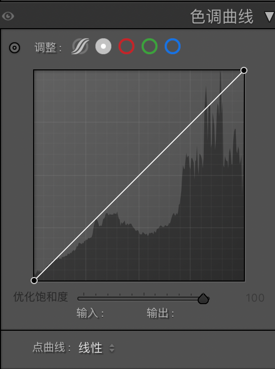

**它是什么？** 更精细的对比度工具，可以分别调整亮暗对比度、红青对比度、绿紫对比度、蓝黄对比度。

### 5.1 怎么理解

- **横轴** = 原来的亮度，**纵轴** = 调整后的亮度；
- **对角线** = 不调整；
- 曲线**上弯** = 变亮，曲线**下弯** = 变暗。

### 5.2 经典 S 曲线（最常用）

1. 点击曲线**中间偏下**的位置，往下拉一点（压暗暗部）；
2. 点击曲线**中间偏上**的位置，往上拉一点（提亮亮部）；
3. 曲线变成"S"形——暗部更沉、亮部更透、中间调对比增强。

### 5.3 适用情况与建议

- **何时用**：基本面板调完后，照片仍然"差点意思"、发灰不够通透时，用 S 曲线收尾；
- **新手建议**：用**参数模式**（点曲线图下方第一个图标，用"高光/亮调/暗调/阴影"四个滑块控制，不容易调崩）。

> ✏️ **动手练习**：找一张阴天拍的灰蒙蒙的照片，先在基本面板做正常调整，然后打开色调曲线拉一个 S 形，对比一下——通透感是不是出来了？

---

## 6. 变换面板——几何矫正

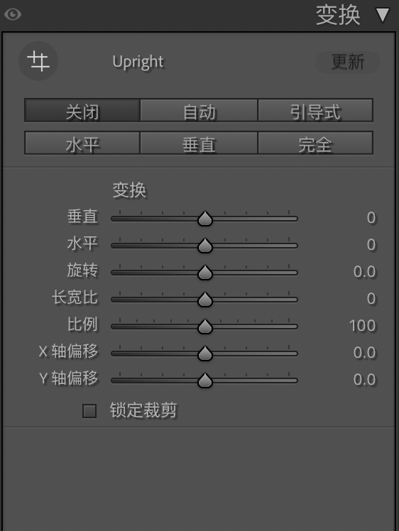

**适用情况**：仰拍建筑导致楼"往后倒"（透视畸变）、地平线歪了、画面需要微调水平。

| 按钮 / 滑块 | 用途 |
|---|---|
| **自动** | 一键矫正，先试它 |
| **水平 / 垂直 / 完全** | 分别只校正水平倾斜 / 只校正垂直线条 / 全都校正 |
| **引导式** | 手动画线：沿着照片里本应垂直的线（门框、灯柱）画一条，Lightroom 自动扶正 |
| **旋转** | 手动微调角度（地平线只差一点点时用） |
| **锁定裁剪** | 勾选后自动裁掉矫正产生的空白边缘 |

---

## 7. 擦除——杂物清场

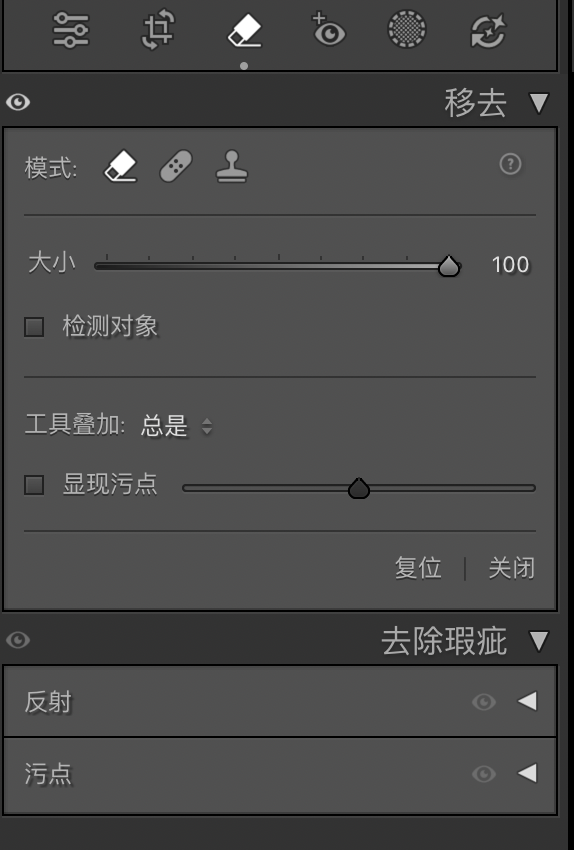

### 7.1 适用情况

- 画面里的**小杂物**：地面的纸屑、桌上的空瓶、墙上的插座；
- **传感器灰尘**造成的污点（逆光小光圈拍摄时特别明显）；
- **小型的路人甲**、乱入的路牌。

### 7.2 三种模式

| 模式 | 原理 | 适合 |
|---|---|---|
| **仿制** | 把源位置的像素原样复制过去 | 有规律纹理（地毯、墙面） |
| **修复** | 复制源像素并自动融合周围光影 | 大多数情况，**默认用它** |
| **内容识别移除** | AI 计算填充 | 结构复杂的背景 |

---

## 8. 蒙版——分区精修

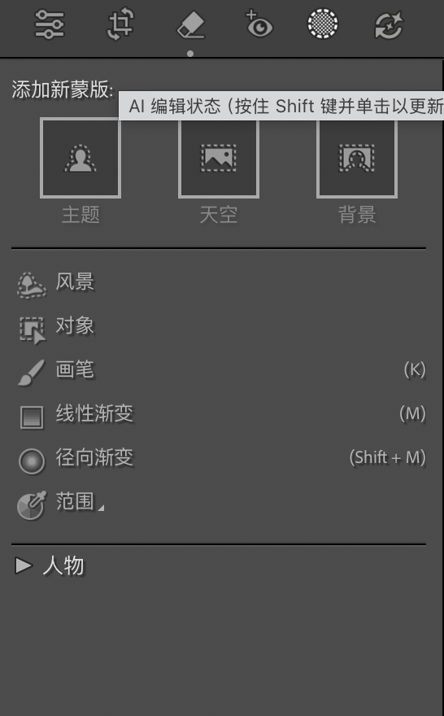

### 8.1 适用情况

- 天空过亮想压暗，但不想把地面压黑；
- 只提亮人物面部，不动背景；
- 只让舞台主体更清晰，周围保持柔和。

### 8.2 操作实战

1. 点击工具栏的**蒙版图标**（快捷键 `Shift + W`）；
2. **先试 AI 蒙版**——点击"**天空**"，Lightroom 自动选中天空（红色覆盖区域即选区）；
3. 选好后右侧出现调整滑块——**只对天空生效**：高光 -50、色温微调偏蓝；
4. 再点"添加新蒙版" → "**主题**"，AI 自动选中人物/主体——只给主体提亮阴影 +30；
5. **"人物"蒙版**展开后还能**单独选中五官**：只调眼睛（提亮+锐化）、只调皮肤（柔肤）——调人像的利器。

### 8.3 AI 选不准，就用手动蒙版

| 工具 | 快捷键 | 适合 |
|---|---|---|
| **画笔** | `K` | 像画画一样涂抹选区，适合不规则区域 |
| **线性渐变** | `M` | 从一端到另一端渐变过渡——压暗天空的经典手法 |
| **径向渐变** | `Shift + M` | 椭圆范围——突出主体、聚光效果 |

---

## 9. 修图流程总结

**一张活动照片从导入到导出的完整流程：**

```text
① 导入 → ② 粗选打星级 → ③ 白平衡 → ④ 曝光（看直方图）
→ ⑤ 高光/阴影/白色/黑色 → ⑥ 裁剪/变换（二次构图 + 扶正）
→ ⑦ 擦除（杂物清场）→ ⑧ 蒙版（分区精修）
→ ⑨ 色调曲线 S 形（通透感收尾）→ ⑩ 细节锐化 → 导出
```

### 三条心法

1. **先全局，后局部**——基本面板定基调，蒙版做精修，顺序反了会来回返工；
2. **随时看直方图**——它是唯一不会骗你的曝光裁判；
3. **每步都克制**——单次调整宁少勿多，观众看不出你修过、只觉得"拍得真好"，就赢了。

</details>